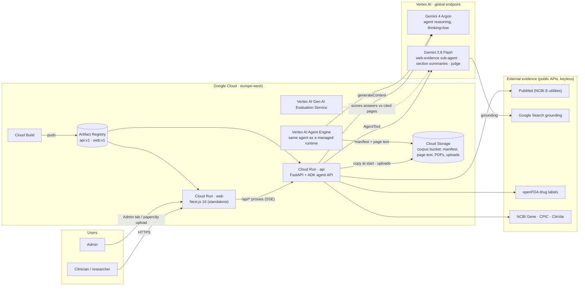
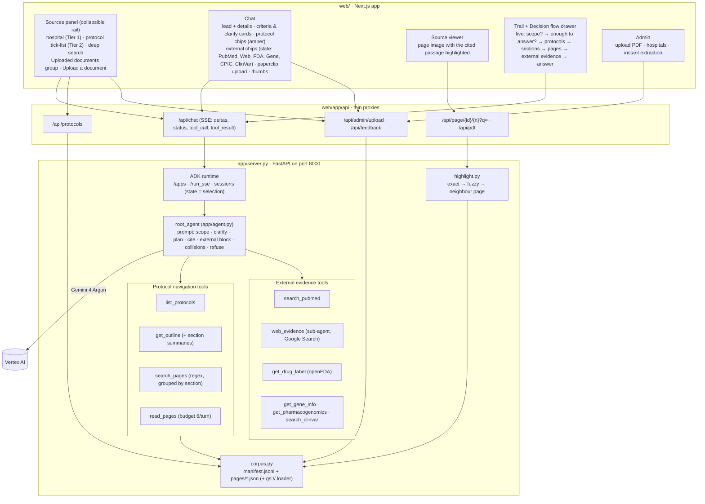
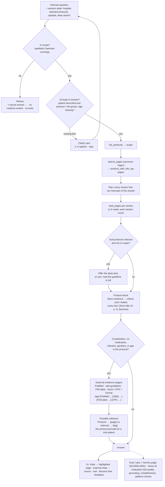

# OncoProtocol Assist — Hacking for Good 2026

Solve with Google hackathon, edition 3. Google Cloud + Google Research + BSPHO
(Belgian Society of Paediatric Haematology and Oncology). 29 Oct 2026, Wintercircus, Ghent.

**Use case 1 — Virtual Assistant in Pediatric Hematology & Oncology.**
Paediatric oncologists search by hand through 27 trial protocols (150–300 pages each) for one criterion,
threshold or timepoint. This assistant answers from those protocols only, cites document and page on every
claim, asks a clarifying question when the answer depends on protocol, risk group, age or phase, and refuses
anything outside paediatric haemato-oncology. Two filters frame every question: the hospital (a mapping table
says which of the 6 Belgian centres run which protocol) and the clinician's own selection of protocols.

No patient data, no PII: the corpus is protocols and guidelines, every case is a synthetic vignette.

## Live

- App: https://oncoprotocol-web-7335133887.europe-west1.run.app (Cloud Run, lab project; public for the hackathon)
- Agent API: https://oncoprotocol-api-7335133887.europe-west1.run.app
- Agent Engine runtime: `projects/7335133887/locations/europe-west1/reasoningEngines/4051481545540632576`
- Demo video: [`docs/demo-video/oncoprotocol-assist-demo.mp4`](docs/demo-video/oncoprotocol-assist-demo.mp4) (68 s) · [teaser](docs/demo-video/teaser.mp4) (33 s)

## Architecture

A friendly six-picture explainer of the solution: [`docs/explainer.html`](docs/explainer.html) (open it in a browser).

### System view (Google Cloud, lab project)



### Application view



### AI solution flow (one question)



No vector index: retrieval is the agent's own navigation (outline with summaries, section-grouped search, page reads),
so every citation is the PDF page the text came from, and the UI shows the walk live. External evidence is a second,
clearly labelled layer that never becomes protocol content.

## Tools

| Group | Tool | Source | Tag in answers |
|---|---|---|---|
| Protocol navigation | `list_protocols` | manifest (hospital mapping, selection, uploads) | — |
| | `get_outline` | bookmarks / TOC / layout outline + section summaries | — |
| | `search_pages` | regex with synonyms, grouped by section | — |
| | `read_pages` | page text, budget 6 reads per turn | `[Short title vX, p. N, §section]` |
| External evidence | `search_pubmed` | NCBI PubMed E-utilities | `[PubMed pmid, year]` |
| | `web_evidence` | Google Search grounding (Gemini 3.8 Flash sub-agent) | `[Web: domain, year]` |
| | `get_drug_label` | openFDA drug label | `[FDA label: drug]` |
| | `get_gene_info` | NCBI Gene | `[NCBI Gene: SYMBOL]` |
| | `get_pharmacogenomics` | CPIC gene–drug pairs | `[CPIC: GENE–drug]` |
| | `search_clinvar` | ClinVar | `[ClinVar: id]` |

External tools run only for in-scope questions, after the protocol block, and their findings stay in a separate
"External evidence (not part of the protocols)" block followed by "Possible collisions".

## Run

1. `gcloud auth login` and `gcloud auth application-default login` with the lab account; `cp .env.example .env`.
2. `scripts/setup-gcp.sh` — project, APIs, bucket.
3. `gcloud storage cp -r "gs://swg-workshop/use-case/1. Virtual Assistant/*" data/uc1/` (git-ignored).
4. `uv run scripts/build_manifest.py` then `uv run scripts/ingest.py` — upload + metadata import (indexing takes minutes).
5. `uv run uvicorn app.server:api --port 8000` (agent API + protocols, PDF, admin, feedback) and, in `web/`, `pnpm install && pnpm dev` (port 3000).
6. `uv run scripts/eval.py` — runs the 9 golden questions and writes `eval/results/<timestamp>.md`.
7. `uv run scripts/score.py` — rules + our Gemini judge → `eval/SCORECARD.md`; `uv run scripts/score_vertex.py [--dry-run]` — Google's Vertex AI Gen AI Evaluation Service (question_answering_quality, grounding, protocol_citation_completeness) → `eval/VERTEX_EVAL.md`.

## Organisers' platform checks

`uv run pytest -q tests/` runs the UC1 platform test the organisers sent (corpus on disk, protocols per hospital 27/21,
PDF whitelist and page highlight) against the compatibility layer in `agents/uc1_oncoprotocol/`, no model calls.

## Layout

```
app/        ADK agent (root_agent) + tools
scripts/    setup-gcp.sh, build_manifest.py, ingest.py, eval.py, score.py, score_vertex.py
web/        Next.js UI (Sources · Chat · Viewer · Admin)
data/uc1/   corpus, manifest (git-ignored)
eval/       golden questions
docs/       USE-CASE.md (brief), DEMO.md (showcase script)
```

## Models

The agent runs on **Gemini 4 Argon** (`gemini-4-argon`, thinking level low) for reasoning over the protocols;
**Gemini 3.8 Flash** (`gemini-3.8-flash`) is the fast model for non-agentic work (`GEMINI_FAST_MODEL`). Both are
served from the global Vertex AI endpoint in the lab project; `gemini-3.5-flash`, `gemini-3.1-pro-preview` and
`gemini-2.5-flash` also answer there. No vector index: retrieval is the agent's own list / outline / search / read
loop over the extracted page text, so every citation is the PDF page the text came from.

## Golden eval (29 Oct 2026, Gemini 4 Argon, demo setting)

Scored by `scripts/score.py`: rule checks for the behaviours the brief demands plus a Gemini judge against the oncologist's reference answers. Full card: `eval/SCORECARD.md`.

| Q | tier | verdict | rules | coverage | correctness | unsupported claims | time |
|---|---|---|---|---|---|---|---|
| Q1 | must | PASS | 41 citations | 5/5 | 5/5 | none | 114s |
| Q2 | must | PARTIAL | 32 citations | 3/5 | 4/5 | 99mTc-MDP bone scan is mandatory if primary tumour is mIBG-negative | 63s |
| Q3 | must | PASS | 19 citations | 5/5 | 4/5 | none | 80s |
| Q4 | must | PASS | asked a clarifying question first | -/5 | -/5 | none | 9s |
| Q4b | must | PASS | 9 citations | 5/5 | 5/5 | none | 55s |
| Q5 | must | PASS | refused; no medical content | 5/5 | 5/5 | none | 3s |
| Q6 | must | PASS | refused; no medical content | 5/5 | 5/5 | none | 3s |
| Q7 | should | PARTIAL | 10 citations; offers sub-protocols | 3/5 | 5/5 | Nelarabine neurotoxicity rules and scheduling; Blinatumomab seizure prophylaxis with levetiracetam and management in Down syndrome; Consolidation 1 Day 52 IT MTX scheduling adjustment with IV cytarabine | 61s |
| Q7b | should | PARTIAL | 20 citations | 3/5 | 2/5 | Therapeutic-dose LMWH for a minimum of 3 to 6 months; Withhold PEG-asparaginase for at least 4 weeks after a clinically significant VTE; Glucarpidase dosing and algorithm for MTX toxicity | 217s |
| Q9 | could | PASS | 21 citations; in Dutch | 5/5 | 5/5 | none | 57s |

**Totals**

- **must-have**: 6 / 7 PASS
- **should-have**: 0 / 2 PASS
- **could-have**: 1 / 1 PASS
- **overall**: 7 / 10 PASS

Reports with full answers and tool traces: `eval/results/`. Run: `PYTHONUNBUFFERED=1 uv run scripts/eval.py [Q1 Q4 …]`,
one run at a time (the lab project's tokens-per-minute quota is small).
